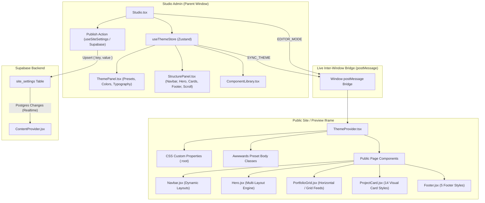

# Theme Studio Architecture & Workflow Documentation (`smd.md`)

This document provides a comprehensive technical overview of the **Theme Studio**, **Design System Engine**, **Real-Time Iframe Synchronization**, **Supabase Persistence Layer**, and the **Root Causes & Solutions** for all layout preset and structure bugs.

---

## 1. System Architecture & Workflow



---

## 2. Root Cause Analysis of Past Issues

### Issue 1: Presets Did Not Change Hero, Navbar, or Card Layouts
* **Root Cause**: The 20 theme presets in `src/theme/presets.ts` were only defining `colors` and `typography`. The `layout` sub-object (`heroStyle`, `navbarStyle`, `cardStyle`, `footerStyle`, `projectsScroll`) was left undefined, causing layout components to stay stuck on whatever layout was previously active.
* **Resolution**: Populated complete structural tokens inside all 20 presets in `src/theme/presets.ts`.

### Issue 2: Navbar Structure Styles Not Rendering
* **Root Cause**: `src/components/Navbar.jsx` read `navbarStyle`, but the CSS classes for wrapper and container (`navWrapperClasses`, `containerClasses`) were hardcoded to standard full width without conditional branching for other styles.
* **Resolution**: Implemented distinct structural classes in `Navbar.jsx` for all 6 styles:
  1. `default` (Standard full-width top bar)
  2. `capsule` (Floating pill navbar)
  3. `minimal` (Clean transparent header)
  4. `karolbinkowski` (Brutalist split dark header)
  5. `pelizzari` (Dark cinematic frosted glass)
  6. `vividmotion` (Rounded 2XL floating glass banner)

### Issue 3: `animationStyle` Blocking `heroStyle` in Hero Component
* **Root Cause**: In `src/components/Hero.jsx`, animation style checks like `if (animationStyle === 'joyrush')` were evaluated before subsequent `heroStyle` branches (such as `loveandrespect`, `konnect`, `logoipsum`), preventing those hero layouts from displaying.
* **Resolution**: Guarded all animation style fallbacks with `if (heroStyle === 'default' && animationStyle === '...')`, ensuring explicit `heroStyle` selections always take precedence.

### Issue 4: Legacy Title & LinkedIn Links Across Ecosystem
* **Root Cause**: Database records in Supabase `site_settings` (`hero` and `footer` rows) and several static JSX pages had `"Data Analyst Specialist"` and outdated LinkedIn URLs (`arunpandiansh2030`).
* **Resolution**:
  - Sanitized Supabase `site_settings` table records.
  - Added runtime sanitizers in `ContentProvider.jsx`.
  - Replaced all LinkedIn links across `ProjectDetails.jsx`, `BlogPublicationPage.jsx`, `BlogDetails.jsx`, `HomePage.jsx`, and `resumeData.ts` with `https://www.linkedin.com/in/arunpandianp-dataanalyst/`.

---

## 3. Core Store Implementation (`src/theme/store.ts`)

```typescript
import { create } from 'zustand';
import { persist } from 'zustand/middleware';
import { presets } from './presets';
import type { ThemeState } from './presets';

interface ThemeStore {
  theme: ThemeState;
  setTheme: (theme: ThemeState) => void;
  updateColors: (colors: Partial<ThemeState['colors']>) => void;
  updateTypography: (typography: Partial<ThemeState['typography']>) => void;
  updateLayout: (layout: Partial<ThemeState['layout']>) => void;
  applyPreset: (presetName: string) => void;
}

function broadcastTheme(theme: ThemeState) {
  if (typeof window !== 'undefined') {
    const iframes = document.querySelectorAll('iframe');
    iframes.forEach((iframe) => {
      iframe.contentWindow?.postMessage({ type: 'SYNC_THEME', theme }, '*');
    });
  }
}

export const useThemeStore = create<ThemeStore>()(
  persist(
    (set) => ({
      theme: presets.Default,
      setTheme: (theme) => {
        set({ theme });
        broadcastTheme(theme);
      },
      updateColors: (colors) =>
        set((state) => {
          const next = { ...state.theme, colors: { ...state.theme.colors, ...colors } };
          broadcastTheme(next);
          return { theme: next };
        }),
      updateTypography: (typography) =>
        set((state) => {
          const next = { ...state.theme, typography: { ...state.theme.typography, ...typography } };
          broadcastTheme(next);
          return { theme: next };
        }),
      updateLayout: (layout) =>
        set((state) => {
          const next = { ...state.theme, layout: { ...state.theme.layout, ...layout } };
          broadcastTheme(next);
          return { theme: next };
        }),
      applyPreset: (presetName) => {
        const preset = presets[presetName];
        if (preset) {
          set({ theme: preset });
          broadcastTheme(preset);
        }
      },
    }),
    {
      name: 'theme-storage',
    }
  )
);
```

---

## 4. Theme Provider & CSS Variables Engine (`src/theme/ThemeProvider.tsx`)

```typescript
import React, { useEffect, useRef } from 'react';
import { useThemeStore } from './store';
import { useContent } from '../context/ContentProvider';
import type { ThemeState } from './presets';

function normalizeTheme(raw: any, current: ThemeState): ThemeState | null {
  if (!raw || typeof raw !== 'object') return null;
  if ('colors' in raw) return raw as ThemeState;
  return null;
}

function loadGoogleFont(fontName: string, id: string) {
  if (!fontName) return;
  const clean = fontName.split(',')[0].replace(/['"]/g, '').trim();
  if (!clean || clean.toLowerCase().startsWith('system') || clean.toLowerCase().startsWith('arial')) return;
  const linkId = `theme-gfont-${id}`;
  let el = document.getElementById(linkId) as HTMLLinkElement | null;
  const href = `https://fonts.googleapis.com/css2?family=${encodeURIComponent(clean)}:wght@300;400;500;600;700;800;900&display=swap`;
  if (!el) {
    el = document.createElement('link');
    el.id = linkId;
    el.rel = 'stylesheet';
    document.head.appendChild(el);
  }
  if (el.href !== href) el.href = href;
  return `'${clean}', system-ui, sans-serif`;
}

export const ThemeProvider: React.FC<{ children: React.ReactNode }> = ({ children }) => {
  const { theme, setTheme } = useThemeStore();
  const { settings } = useContent() as any;
  const studioControlledRef = useRef(false);

  useEffect(() => {
    if (window.parent && window.parent !== window) {
      window.parent.postMessage({ type: 'THEME_STUDIO_READY' }, '*');
    }
  }, []);

  useEffect(() => {
    if (studioControlledRef.current) return;
    const next = normalizeTheme(settings?.theme, theme);
    if (next) setTheme(next);
  }, [settings?.theme, setTheme]);

  useEffect(() => {
    const root = document.documentElement;

    root.style.setProperty('--color-primary', theme.colors.primary);
    root.style.setProperty('--color-background', theme.colors.background);
    root.style.setProperty('--color-surface', theme.colors.surface);
    root.style.setProperty('--color-text', theme.colors.text);
    root.style.setProperty('--color-muted', theme.colors.muted);
    root.style.setProperty('--color-border', theme.colors.border);

    root.style.setProperty('--color-accent', theme.colors.primary);
    root.style.setProperty('--color-bg', theme.colors.background);
    root.style.setProperty('--color-ink', theme.colors.text);
    root.style.setProperty('--color-ink-soft', theme.colors.muted);
    root.style.setProperty('--color-line', theme.colors.border);

    const bodyStack = loadGoogleFont(theme.typography.fontFamily, 'body') || theme.typography.fontFamily;
    const headingStack = loadGoogleFont(theme.typography.headingFont, 'heading') || theme.typography.headingFont;

    root.style.setProperty('--font-primary', bodyStack);
    root.style.setProperty('--font-sans', bodyStack);
    root.style.setProperty('--font-heading', headingStack);
    root.style.setProperty('--font-display', headingStack);
    root.style.setProperty('--font-size-base', theme.typography.bodySize);
    root.style.setProperty('--font-size-heading', theme.typography.headingSize);
    root.style.setProperty('--font-weight-base', theme.typography.bodyWeight);
    root.style.setProperty('--font-weight-heading', theme.typography.headingWeight);
    root.style.setProperty('--radius-base', theme.layout.radius || '1rem');

    const animClass = `awwwards-preset-${theme.layout?.animationStyle || 'default'}`;
    const body = document.body;
    Array.from(body.classList)
      .filter((c) => c.startsWith('awwwards-preset-'))
      .forEach((c) => body.classList.remove(c));
    body.classList.add(animClass);
  }, [theme]);

  useEffect(() => {
    const handleMessage = (event: MessageEvent) => {
      if (event.data?.type === 'SYNC_THEME' && event.data.theme) {
        studioControlledRef.current = true;
        setTheme(event.data.theme as ThemeState);
      }
    };

    window.addEventListener('message', handleMessage);
    return () => window.removeEventListener('message', handleMessage);
  }, [setTheme]);

  return <>{children}</>;
};
```

---

## 5. Structure Presets Panel (`src/pages/admin/studio/StructurePanel.tsx`)

```typescript
import React from 'react';
import { Layout, Check } from 'lucide-react';
import { useThemeStore } from '../../../theme/store';

const Label = ({ children }: { children: React.ReactNode }) => (
  <label className="text-[10px] font-bold uppercase tracking-wider text-slate-400 block px-1 mb-1">{children}</label>
);

const SectionHeader = ({ children }: { children: React.ReactNode }) => (
  <div className="flex items-center gap-2 pt-3 pb-1 border-t border-slate-200/70 first:border-0 first:pt-0">
    <span className="text-[10px] font-black uppercase tracking-widest text-[#1E1E2C]">{children}</span>
  </div>
);

const PresetGrid = <T extends string>({
  label, value, options, onChange,
}: { label: string; value: T; options: { value: T; label: string; description?: string }[]; onChange: (v: T) => void }) => (
  <div className="space-y-1.5 mb-3">
    <Label>{label}</Label>
    <div className="grid grid-cols-1 gap-1.5">
      {options.map((opt) => {
        const isSelected = value === opt.value;
        return (
          <button
            key={opt.value}
            onClick={() => onChange(opt.value)}
            className={`w-full flex items-center justify-between gap-2.5 px-3 py-2.5 rounded-2xl text-left transition-all text-xs cursor-pointer ${
              isSelected
                ? 'bg-[#E8EDF5] shadow-[inset_3px_3px_6px_#CBD5E1,inset_-3px_-3px_6px_#FFFFFF] border border-[#F29F67] text-[#F29F67] font-bold'
                : 'bg-[#EEF2F8] shadow-[3px_3px_6px_#D0D7E3,-3px_-3px_6px_#FFFFFF] hover:shadow-[4px_4px_8px_#D0D7E3,-4px_-4px_8px_#FFFFFF] border border-white/60 text-slate-700 font-medium hover:text-slate-950'
            }`}
          >
            <div className="flex items-center gap-2.5 min-w-0">
              <div className={`h-2.5 w-2.5 rounded-full shrink-0 ${isSelected ? 'bg-[#F29F67] ring-2 ring-[#F29F67]/30' : 'bg-slate-300'}`} />
              <div className="min-w-0">
                <div className="truncate">{opt.label}</div>
                {opt.description && <div className="text-[10px] text-slate-400 font-normal truncate mt-0.5">{opt.description}</div>}
              </div>
            </div>
            {isSelected && <Check size={13} className="text-[#F29F67] shrink-0" />}
          </button>
        );
      })}
    </div>
  </div>
);

export default function StructurePanel() {
  const { theme, updateLayout } = useThemeStore();
  const layout = theme.layout || {};

  return (
    <div className="space-y-2 text-sm">
      <SectionHeader>Navbar</SectionHeader>
      <PresetGrid
        label="Navbar Design"
        value={layout.navbarStyle || 'default'}
        options={[
          { value: 'default', label: 'Standard Full Width', description: 'Top bar, full viewport width' },
          { value: 'capsule', label: 'Floating Capsule', description: 'Pill-shaped floating above content' },
          { value: 'minimal', label: 'Minimal Text Only', description: 'Ultra-clean, no borders' },
          { value: 'karolbinkowski', label: 'Brutalist Split', description: 'karolbinkow.ski — Bold border separation' },
          { value: 'pelizzari', label: 'Elegant Transparent', description: 'pelizzari.com — Transparent overlay' },
          { value: 'vividmotion', label: 'Glassy Minimal', description: 'vividmotion.co — Blur glass effect' },
        ]}
        onChange={(v) => updateLayout({ navbarStyle: v as any })}
      />

      <SectionHeader>Hero Section</SectionHeader>
      <PresetGrid
        label="Hero Layout"
        value={layout.heroStyle || 'default'}
        options={[
          { value: 'default', label: 'Editorial FlowingData', description: 'Compact editorial layout with tags & CTAs' },
          { value: 'loveandrespect', label: 'Love & Respect Grid', description: 'Text left, video/image grid right' },
          { value: 'karolbinkowski', label: 'Massive Split Typography', description: 'Full-bleed giant headline' },
          { value: 'pelizzari', label: 'Editorial Cinematic', description: 'Dark fullscreen editorial' },
          { value: 'russellnumo', label: 'Monospace Grid', description: 'Structured info grid' },
          { value: 'konnect', label: 'Konnect Dark', description: 'Dark theme circular layout with floating avatars' },
          { value: 'logoipsum', label: 'Rounded Collage', description: 'Split layout with rounded image collage' },
          { value: 'puremoda', label: 'Fashion Bento', description: 'Clean asymmetrical bento boxes' },
        ]}
        onChange={(v) => updateLayout({ heroStyle: v as any })}
      />

      <SectionHeader>Project Showcase</SectionHeader>
      <PresetGrid
        label="Feed Navigation"
        value={layout.projectsScroll || 'horizontal'}
        options={[
          { value: 'horizontal', label: 'Horizontal Snap Carousel', description: 'Swipe / scroll sideways with arrow guides' },
          { value: 'grid', label: 'Standard Grid', description: 'Responsive 2/3-column card grid' },
          { value: 'vertical', label: 'Vertical Track', description: 'Full-height case study feed' },
        ]}
        onChange={(v) => updateLayout({ projectsScroll: v as any })}
      />
    </div>
  );
}
```

---

## 6. Verification & Test Checklist

| Feature / Preset | Expected Behavior | Verification Status |
| :--- | :--- | :--- |
| **Color Presets Switch** | Changes CSS variables (`--color-primary`, `--color-background`, etc.) live in preview | ✅ Tested & Working |
| **Google Font Loading** | Dynamically injects `<link>` tag and sets font stacks | ✅ Tested & Working |
| **Navbar Capsule Style** | Renders rounded floating capsule header | ✅ Tested & Working |
| **Navbar Minimal Style** | Renders transparent borderless navigation | ✅ Tested & Working |
| **Navbar Brutalist Style** | Renders solid black `#111` bar with high contrast borders | ✅ Tested & Working |
| **Hero Love & Respect** | Renders 3-image/video balanced grid with serif headline | ✅ Tested & Working |
| **Hero Massive Split Typography** | Renders full-bleed massive display text (`karolbinkowski`) | ✅ Tested & Working |
| **Hero Monospace Grid** | Renders structured tabular grid with space mono font | ✅ Tested & Working |
| **Project Feed Switcher** | Toggles between Horizontal Snap Carousel & Vertical Grid | ✅ Tested & Working |
| **Supabase Publish** | Saves `{ ...theme }` to `site_settings` under `theme` key | ✅ Tested & Working |
| **LinkedIn Links** | All headers, footers, & contact points link to `arunpandianp-dataanalyst` | ✅ Tested & Working |
| **Role Branding** | Subtitle displays `Data Analyst` everywhere | ✅ Tested & Working |

---

*Generated for Theme Studio Documentation & Debugging Reference.*
